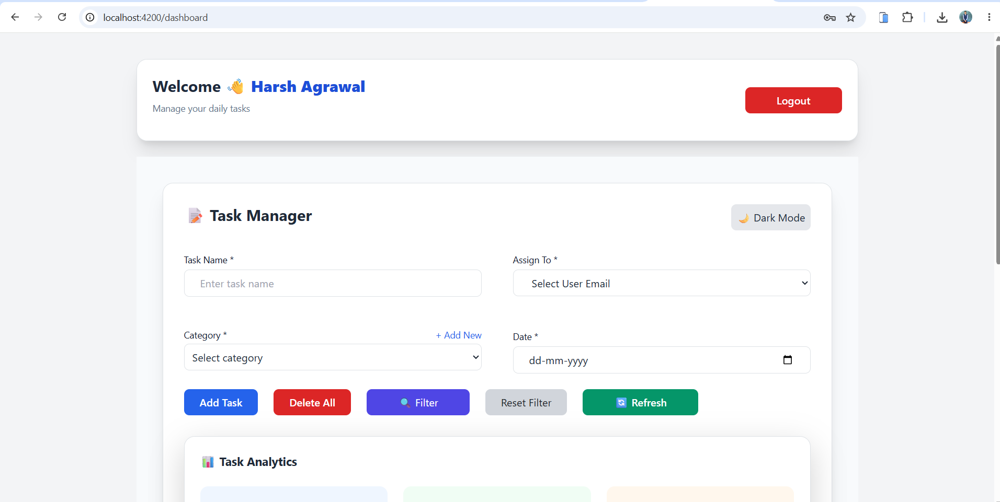
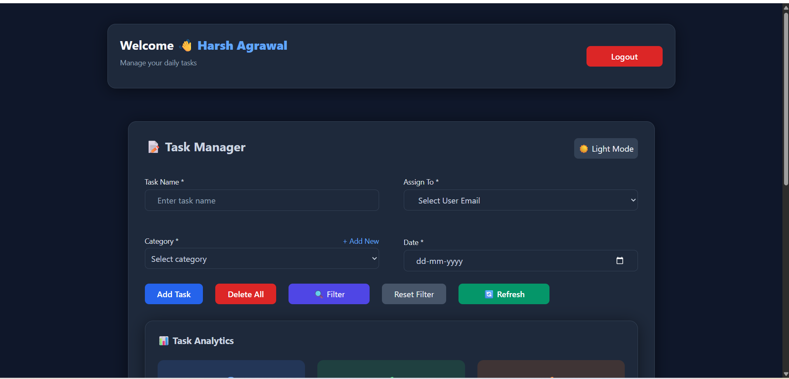
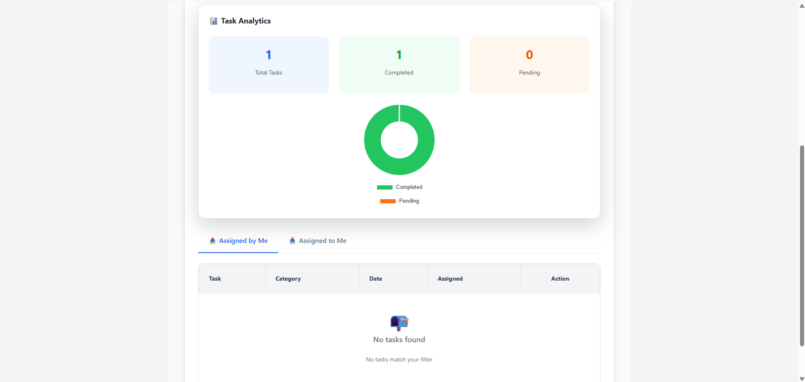
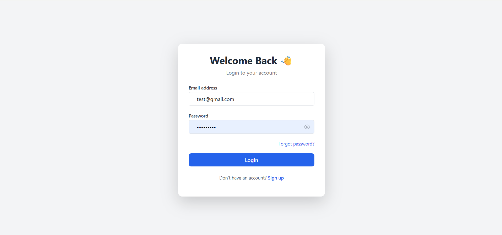
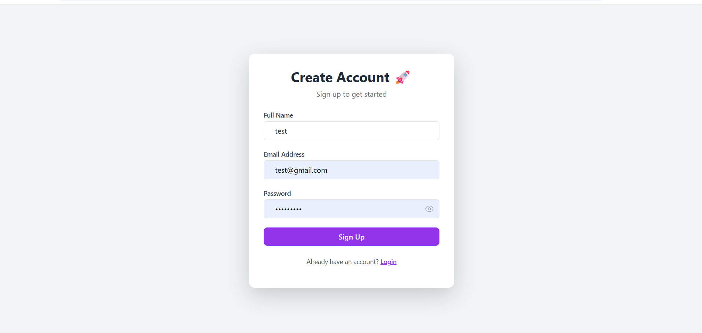
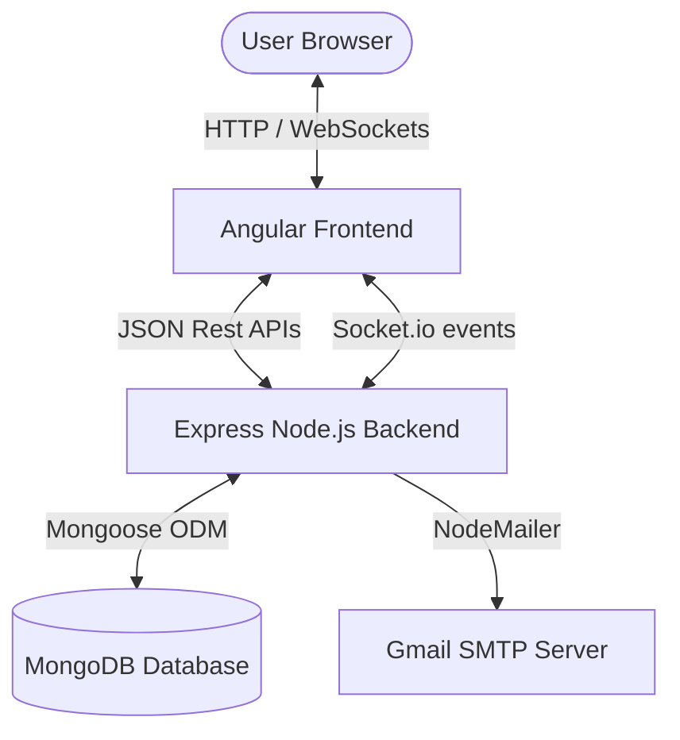

# 📝 Real-Time Task Manager

A modern, full-stack Task Management application built using the **MERN** stack variation (MongoDB, Express, Angular, and Node.js) featuring real-time state synchronization via **Socket.io** and interactive data analytics using **Chart.js**.

---

## 🚀 Key Features

*   **🔒 Secure Authentication**:
    *   Sign-up & Login with encrypted passwords (via `bcryptjs`).
    *   One-Time Password (OTP) verification for email verification.
    *   Secure reset/forgot password flows.
    *   State protection with client-side Angular Auth Guards and server-side JWT authentication.
*   **⚡ Real-Time Synchronization**:
    *   Instant task updates and category changes pushed to all active clients via **Socket.io**.
*   **📊 Dynamic Task Analytics**:
    *   Interactive charts powered by **Chart.js** displaying metrics for Total, Completed, and Pending tasks.
*   **🎨 Premium Responsive UI**:
    *   Polished UI styled with TailwindCSS, supporting system/user preference **Dark Mode** toggle.
*   **📂 Structured Organization**:
    *   Support for grouping tasks under custom categories.
*   **🖨️ Architecture Diagrams**:
    *   Interactive Level-0 and Level-1 Data Flow Diagrams (DFD) built directly into [dfd_diagrams.html](file:///e:/task_Manager_Angular/dfd_diagrams.html).

---

## 📸 Screenshots & UI Preview

### 🏠 Dashboard Overview
| 🌟 Light Mode | 🌙 Dark Mode |
| :---: | :---: |
|  |  |

### 📊 Dynamic Analytics & Charts
| 📈 Task Analytics & Metrics |
| :---: |
|  |

### 🔐 Authentication Flow
| 🔑 Login | 📝 Sign-Up |
| :---: | :---: |
|  |  |

---

## 🏛️ System Architecture



---

## 📂 Project Structure

```text
task_Manager_Angular/
├── backend/                  # Node.js + Express backend
│   ├── config/               # DB, JWT, and Mailer configurations
│   ├── controllers/          # Business logic handlers
│   ├── middleware/           # JWT verification, CORS settings
│   ├── models/               # Mongoose schemas (User, Task, Category)
│   ├── routes/               # API endpoints
│   ├── package.json          # Node dependencies & startup scripts
│   └── server.js             # Main server entrypoint
│
├── frontend/                 # Angular 21 frontend
│   ├── public/               # Static assets
│   ├── src/
│   │   ├── app/              # Component structures
│   │   │   ├── auth/         # Login, signup, otp, reset password
│   │   │   ├── dashboard/    # Home dashboard, task charts, task modals
│   │   │   ├── guards/       # Route activation guards
│   │   │   └── services/     # API communicators, WebSocket client, theme controls
│   │   ├── environments/     # Environment-specific configuration keys
│   │   ├── index.html        # Main app entry template
│   │   ├── main.ts           # Angular boostrapper
│   │   └── styles.css        # Global CSS stylesheet (Tailwind directives)
│   ├── tailwind.config.js    # Tailwind layout options
│   └── package.json          # Angular scripts & dependencies
│
└── dfd_diagrams.html         # Data Flow Diagram (DFD) page
```

---

## 🗄️ Database Schema

### 1. `User` Schema
```javascript
{
  name: { type: String, required: true },
  email: { type: String, unique: true, required: true },
  password: { type: String, required: true },
  token: { type: String, default: null }, // Active JWT session token
  otp: { type: String },
  otpExpire: { type: Date }
}
```

### 2. `Task` Schema
```javascript
{
  taskName: { type: String, required: true },
  assignedTo: { type: ObjectId, ref: 'User', required: true },
  category: { type: String, required: true },
  date: { type: Date, required: true },
  completed: { type: Boolean, default: false },
  userId: { type: ObjectId, ref: 'User', required: true }
}
```

### 3. `Category` Schema
```javascript
{
  name: { type: String, unique: true, required: true },
  userId: { type: ObjectId, ref: 'User', required: true }
}
```

---

## ⚙️ Setup and Installation

### Prerequisites
*   [Node.js](https://nodejs.org/) (v18.x or above)
*   [MongoDB](https://www.mongodb.com/) (Running instance locally or MongoDB Atlas)

---

### Backend Configuration

1.  Navigate to the backend directory:
    ```bash
    cd backend
    ```
2.  Install dependencies:
    ```bash
    npm install
    ```
3.  Configure environment variables. Copy the `.env.example` to `.env`:
    ```bash
    cp .env.example .env
    ```
4.  Edit the `.env` file with your credentials:
    ```env
    PORT=5000
    MONGO_URI=your_mongodb_connection_uri
    JWT_SECRET=your_secret_key_here
    EMAIL_USER=your_gmail_address
    EMAIL_PASS=your_gmail_app_password
    CORS_ORIGIN=http://localhost:4200
    ```

---

### Frontend Configuration

1.  Navigate to the frontend directory:
    ```bash
    cd ../frontend
    ```
2.  Install dependencies:
    ```bash
    npm install
    ```
3.  Make sure the environment configuration file exists. In `src/environments/environment.ts`, define your endpoints:
    ```typescript
    export const environment = {
      production: false,
      apiUrl: 'http://localhost:5000/api',
      socketUrl: 'http://localhost:5000'
    };
    ```

---

## 🏃 Running the Application

For a fully functioning application, start both the backend server and the frontend development server.

### Start the Backend Server
```bash
cd backend
# Using nodemon for hot-reloads (if installed globally/locally)
npm run dev
# OR start normally
npm start
```
The server will boot up on `http://localhost:5000` with WebSockets configured.

### Start the Angular Frontend
```bash
cd frontend
# Launch development server
npm run start
# OR using Angular CLI globally
ng serve
```
Open your browser and navigate to `http://localhost:4200/`.

---

## 📊 Viewing Data Flow Diagrams (DFDs)
To see how data flows through the application, open [dfd_diagrams.html](file:///e:/task_Manager_Angular/dfd_diagrams.html) in your browser:
*   Double click `dfd_diagrams.html` in your file explorer, or
*   Open the file directly using your web browser.
*   You can print or save the DFD diagrams as a PDF by clicking the **Print / Save as PDF** button at the top of the page.
